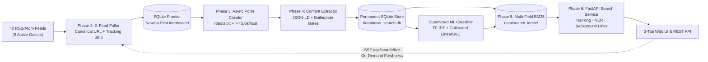

# News Search & Classification Engine


An end-to-end, polite, query-driven **News Search and Classification Engine** that autonomously discovers, crawls, extracts, classifies, indexes, and contextually links live multi-outlet news articles. Built across six cleanly decoupled phases with an interactive 3-tab FastAPI web interface, real-time Server-Sent Events (SSE) query-triggered crawling, multi-field Okapi BM25 ranking, outlet-debiased supervised ML classification, debiased Named Entity Recognition (NER), and TREC-style background story linking.

---

## Key Features

- **Polite Multi-Domain Async Crawler (`Phases 1–3`)**: Monitors **42 balanced RSS/Atom feeds** across **9 active international and Indian outlets** (`BBC News`, `The Guardian`, `Al Jazeera`, `The Hindu`, `The Indian Express`, `Hindustan Times`, `Times of India`, `The Economic Times`, `India Today`) with strict **RFC 9309 `robots.txt`** compliance, per-host `>= 5.0s` rate limiting, honest `NewsSearchBot/1.0` User-Agent identification, exponential retry backoff, and newest-first domain-interleaved scheduling.
- **Query-Driven Live News Retrieval (SSE)**: Returns sub-10 ms BM25 results immediately from the local index while an asynchronous SSE stream (`GET /api/search/live`) polls stale feeds, matches pending frontier metadata, performs allowlisted domain-scoped discovery, politely crawls breaking matching stories, updates SQLite + BM25 incrementally, and pushes freshly crawled results to the UI with `NEW · Crawled Just Now` badges.
- **Shallow-Feature Boilerplate Extraction (`Phase 4`)**: Extracts structured metadata via JSON-LD, OpenGraph, and DOM fallbacks while rejecting navigation-heavy or stub pages (`link-to-text ratio <= 0.45`, `>= 100 words`), stripping datelines (`Updated - ...`), inline photo credits, promotional boilerplate, and URL tracking parameters (`utm_*`, `fbclid`, `at_*`).
- **Multi-Field Okapi BM25 Search (`Phase 5–6`)**: Separate inverted indices across five weighted fields (`Headline 3.0x`, `Kicker 2.0x`, `Author 1.5x`, `Date 1.0x`, `Body 1.0x`), enhanced with phrase-aware domain synonym expansion (`0.25x`), quoted exact phrases, 4-digit year enforcement, soft-AND concept quorum (`0.6`), ordered bigram/phrase proximity boosts (`+40%` title / `+25%` body), exponential recency tie-breaking (`+10%`), and `< 1 ms` bucketed spell correction (`Did you mean`).
- **Outlet-Debiased Supervised ML Classification**: Classifies articles strictly from text (`title` 3x weighted + `body_text`, publisher names scrubbed) into **8 canonical categories** (`world`, `india`, `business`, `technology`, `sport`, `science_health`, `politics`, `entertainment`) using **TF-IDF (1,2)-gram + Platt-Calibrated Balanced LinearSVC**. Surfaces **borderline Top-2 predictions** whenever top confidence falls below `50%` (e.g., `Technology 37% / Business 34%`).
- **Debiased NER & Hybrid Background Linking**: Combines curated institutional ORG gazetteers (financial, tech, AI, philanthropic entities), wire/publisher exclusion, context-verified PERSON extraction, and author-byline separation with sparse TF-IDF cosine + IDF-weighted entity overlap for topical background story recommendations.
- **3-Tab XSS-Safe Web UI**: Interactive Search tab (category/source facets, relevance/latest sorting, full-article reader modal, dark/light themes, IR debug inspector), live **ML & IR Evaluation** dashboard, and **Crawler & Corpus** health monitor.

---

## System Architecture



---

## Project Structure

```text
.
├── pyproject.toml                  # Package metadata, dependencies & pytest config
├── robots.txt                      # Local server robots.txt policy
├── scripts/
│   ├── benchmark_queries.py        # 15-query precision, NER hygiene & latency benchmark
│   └── evaluate_system.py          # Full IR (MAP/nDCG/MRR), ML & background-link evaluator
├── src/
│   ├── pipeline.py                 # Unified CLI runner (init, poll, crawl, train-classifier, index, run, daemon, serve)
│   ├── models/                     # Pydantic v2 schemas, canonical categories & URL normalizer
│   ├── storage/                    # SQLite schema initialization & repository queries
│   ├── poller/                     # RSS/Atom parser, async/sync feed poller & allowlisted discovery
│   ├── crawler/                    # RFC 9309 robots.txt cache & sync/async polite crawlers
│   ├── extractor/                  # HTML boilerplate removal, metadata extraction & persistence
│   ├── indexer/                    # Preprocessing, Porter stemming & multi-field BM25 index
│   └── search/
│       ├── api.py                  # FastAPI REST API, SSE live crawl stream & web UI routes
│       ├── classifier.py           # TF-IDF + Calibrated LinearSVC & borderline Top-2 logic
│       ├── context.py              # Debiased NER & hybrid TF-IDF + entity-IDF background linking
│       ├── evaluation.py           # P@k, R@k, AP/MAP, nDCG@k & MRR metrics
│       ├── expansion.py            # Concept grouping & phrase-aware synonym expansion
│       ├── live_retriever.py       # Query-driven polite live crawl orchestrator
│       ├── service.py              # Read-only search facade with pre-warmed caches
│       ├── snippets.py             # Passage windowing, punctuation cleanup & highlighting
│       └── templates/              # Single-source-of-truth HTML UI, logo & background assets
└── tests/                          # 52 unit & integration tests covering Phases 1–6
```

---

## Quick Start

### 1. Prerequisites & Installation

Requires **Python 3.11+**.

```powershell
# Create and activate a virtual environment (Windows PowerShell)
python -m venv .venv
.\.venv\Scripts\Activate.ps1

# Install project & dev dependencies
pip install -e ".[dev]"
pip install scikit-learn joblib
```

*(On Linux/macOS, activate with `source .venv/bin/activate`.)*

### 2. Run the Web UI & API

If `data/news_search.db` and `data/search_index/` are already populated:

```powershell
python -m src.pipeline serve --host 127.0.0.1 --port 8010
```

Open **http://127.0.0.1:8010/** in your browser. *(Default port is `8000` if `--port` is omitted.)*

### 3. Build Corpus from Scratch (Full Pipeline)

Run all ingestion, extraction, training, and indexing phases end to end:

```powershell
# 1. Initialize SQLite + 42 balanced feeds, poll RSS, politely crawl & index
python -m src.pipeline run --expand-feeds --limit 100 --concurrency 8 -v

# 2. Train & cross-validate the supervised ML category classifier
python -m src.pipeline train-classifier -v

# 3. Rebuild the search index with calibrated ML category & Top-2 predictions
python -m src.pipeline index --rebuild -v

# 4. Launch the web UI
python -m src.pipeline serve --host 127.0.0.1 --port 8010
```

---

## CLI Command Reference

All pipeline operations are exposed via `python -m src.pipeline`:

| Command | Description |
| :--- | :--- |
| `init [--expand-feeds]` | Initialize `data/news_search.db` and register RSS feeds (`42` with `--expand-feeds`). |
| `poll [--expand-feeds] [-v]` | Poll active RSS/Atom feeds into `crawl_frontier` with ETag/Last-Modified support. |
| `crawl --limit 100 --concurrency 8 [-v]` | Politely crawl pending frontier URLs (`>= 5.0s`/host) and extract valid articles. |
| `train-classifier [-v]` | Train 5-fold Stratified CV `TF-IDF + Calibrated LinearSVC` -> `data/models/`. |
| `index [--rebuild] [-v]` | Incrementally sync (or cleanly rebuild) `data/search_index/` from SQLite. |
| `run --expand-feeds --limit 100 [-v]` | Run `init -> poll -> crawl/extract -> index` sequentially. |
| `daemon --expand-feeds --interval-minutes 30` | Continuously poll, crawl, and incrementally index new stories in the background. |
| `status` | Print live SQLite feed/frontier/article counts and BM25 index statistics. |
| `search "query" [--k 10] [--category ...] [--source ...]` | Execute a multi-field BM25 query directly from the terminal. |
| `serve [--host 127.0.0.1] [--port 8000]` | Start the FastAPI web UI, REST API, and SSE live-crawl server. |

---

## REST API & SSE Endpoints

| Endpoint | Method | Purpose |
| :--- | :---: | :--- |
| `/` | `GET` | 3-tab interactive News Search, Evaluation & Crawler Web UI |
| `/api/search` | `GET` | Multi-field BM25 search (`q`, `k`, `category`, `source`, `sort`, `date_from`, `date_to`) |
| `/api/search/live` | `GET` | SSE stream for polite query-driven live feed polling, crawling & index refresh |
| `/api/crawl-for-query` | `POST` | Synchronous trigger for query-driven polite live crawling |
| `/api/articles/{doc_id}` | `GET` | Full article body, metadata, debiased NER entities & background links |
| `/api/articles/{doc_id}/background` | `GET` | Related background stories for a specific `doc_id` |
| `/api/corpus` | `GET` | Live index coverage counts, category/source facets & sample queries |
| `/api/stats` | `GET` | Live SQLite feed, frontier queue, and article telemetry |
| `/api/classifier/metrics` | `GET` | Persisted 5-fold CV accuracy, Macro-F1, per-class metrics & top features |
| `/api/evaluate` / `/api/evaluate/default` | `POST` / `GET` | Evaluate BM25 ranking (MAP, nDCG@k, MRR, P@k, R@k) |
| `/health` & `/robots.txt` | `GET` | Health probe & crawler policy endpoint |

---

## Evaluation & Verified Results

Evaluated against the live multi-outlet corpus (**657 indexed articles**, **9 active outlets**, **42 RSS feeds**):

| Metric / Verification Gate | Result |
| :--- | :--- |
| **IR Ranking (12 Curated TREC-Style Queries, `k = 10`)** | **MAP = `0.8651`**, **Mean nDCG@10 = `0.9157`**, **MRR = `1.0000`** |
| **Warm Query Latency (15-Query Benchmark, Median of 3)** | **Avg = `7.88 ms`**, **Max = `16.71 ms`** (`< 25 ms` target) |
| **Out-of-Corpus Query Precision** | **`0 / 2`** false hits (`mars colony 2099`, `xyzzy nonexistent topic`) |
| **Deployed ML Classifier (5-Fold CV, 8 Classes, `n = 516`)** | **Accuracy = `70.54%`**, **Macro-F1 = `72.36%`**, **Weighted-F1 = `70.53%`** |
| **Expanded Live Ablation (`n = 651`, Text-Only)** | **Calibrated LinearSVC = `72.04%`** vs. Lexical Baseline `49.46%` (`+22.6 pts`) |
| **UI Filter vs. Predicted Badge Parity** | **`0 / 657`** mismatches (`100%` consistent) |
| **Debiased NER & Background Linking Purity** | **`0`** publisher/wire ORGs; **`0 / 1,380`** publisher-only false links |
| **Automated Test Suite (`pytest -v`)** | **`52 / 52`** unit & integration tests passing |

### Running Tests & Benchmarks

```powershell
# Run full unit & integration test suite (52 tests)
python -m pytest -v

# Run 15-query precision, NER hygiene & warm latency benchmark
python scripts/benchmark_queries.py

# Run full IR, ML classifier & background-link system evaluation
python scripts/evaluate_system.py
```

---

## Ethical Crawling & Engineering Guarantees

- **Strict `robots.txt` Enforcement**: Every target URL is checked against cached host rules (`RFC 9309`) before fetching; disallowed URLs are marked `skipped`.
- **Per-Domain Politeness**: Enforces a minimum **5.0-second** delay between consecutive requests to the same hostname, even during concurrent multi-domain or live query-driven crawls.
- **Transparent Identification**: Uses an honest `NewsSearchBot/1.0` User-Agent header and never attempts to bypass paywalls or anti-bot challenges.
- **Decoupled Permanent Storage**: Validated articles in `data/news_search.db` are never dropped or mutated by indexing or search operations, and all timestamps are normalized to ISO 8601 UTC.
